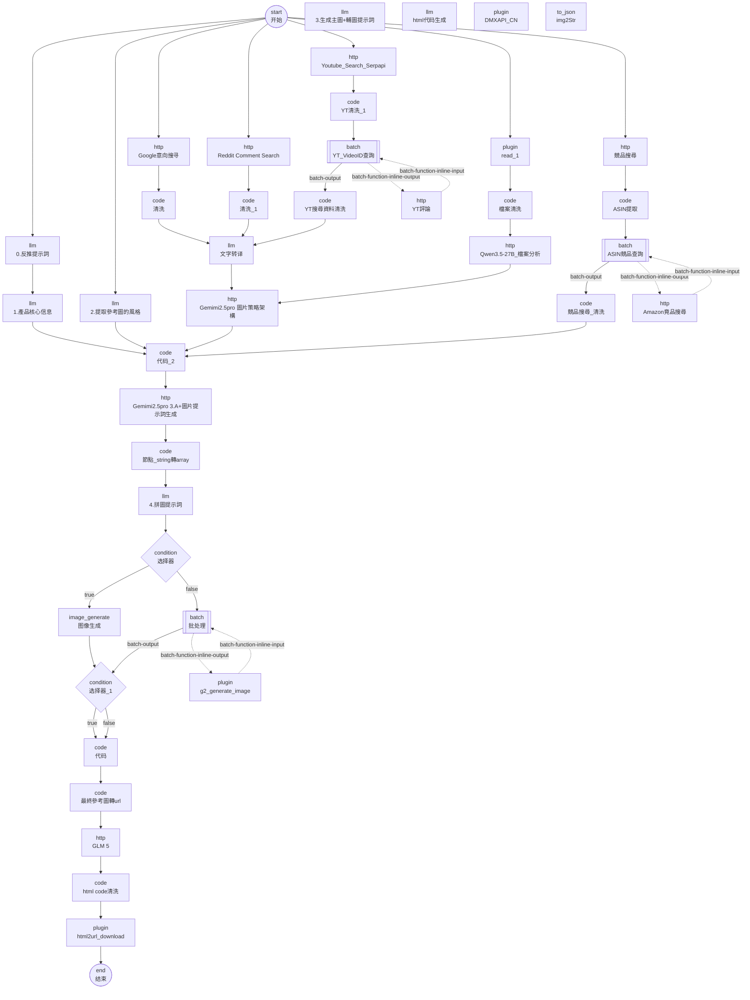

# Amazon A+ 圖片生成(A_jia_TORRAS) — DAG 連線圖與執行順序

來源:`A_jia_TORRAS/workflow/A_jia_TORRAS-draft.yaml`(Coze 匯出,已消毒;金鑰為 `${VAR}` 佔位符)

| 統計 | 值 |
| --- | --- |
| 節點總數(含批次子節點) | 44 |
| 頂層節點 | 41 |
| 批次容器內子節點 | 3 |
| 頂層連線 | 42 |
| 批次容器內部連線 | 6 |
| DAG 最大層深 | 19 |
| 條件分支節點 | 2 |
| 批次節點 | 3 |
| 節點型別分布 | batch×3, code×12, comment×2, condition×2, end×1, http×10, image_generate×1, llm×7, plugin×4, start×1, to_json×1 |

## 執行順序(拓樸排序)

| # | 層深 | 型別 | 節點 | ID | 可否本機執行 | 節點檔 |
| --- | --- | --- | --- | --- | --- | --- |
| 1 | 0 | start | 开始 | `100001` | 是 | [01-开始.md](nodes/01-开始.md) |
| 2 | 1 | llm | 2.提取參考圖的風格 | `185690` | 否(需 Coze) | [02-2.提取參考圖的風格.md](nodes/02-2.提取參考圖的風格.md) |
| 3 | 0 | llm | 3.生成主圖+輔圖提示詞 ⚠孤立 | `195000` | 否(需 Coze) | [03-3.生成主圖+輔圖提示詞.md](nodes/03-3.生成主圖+輔圖提示詞.md) |
| 4 | 1 | llm | 0.反推提示詞 | `138410` | 否(需 Coze) | [04-0.反推提示詞.md](nodes/04-0.反推提示詞.md) |
| 5 | 2 | llm | 1.產品核心信息 | `193707` | 否(需 Coze) | [05-1.產品核心信息.md](nodes/05-1.產品核心信息.md) |
| 6 | 0 | comment | （未命名） ⚠孤立 | `143458` | 是 | [06-comment.md](nodes/06-comment.md) |
| 7 | 1 | http | Google意向搜寻 | `144826` | 是 | [07-Google意向搜寻.md](nodes/07-Google意向搜寻.md) |
| 8 | 0 | llm | html代码生成 ⚠孤立 | `135189` | 否(需 Coze) | [08-html代码生成.md](nodes/08-html代码生成.md) |
| 9 | 1 | http | Reddit Comment Search | `118241` | 是 | [09-Reddit_Comment_Search.md](nodes/09-Reddit_Comment_Search.md) |
| 10 | 2 | code | 清洗 | `113844` | 是 | [10-清洗.md](nodes/10-清洗.md) |
| 11 | 2 | code | 清洗_1 | `1791005` | 是 | [11-清洗_1.md](nodes/11-清洗_1.md) |
| 12 | 0 | plugin | DMXAPI_CN ⚠孤立 | `143538` | 否(需 Coze) | [12-DMXAPI_CN.md](nodes/12-DMXAPI_CN.md) |
| 13 | 0 | comment | （未命名） ⚠孤立 | `105378` | 是 | [13-comment.md](nodes/13-comment.md) |
| 14 | 0 | to_json | img2Str ⚠孤立 | `163345` | 否(需 Coze) | [14-img2Str.md](nodes/14-img2Str.md) |
| 15 | 1 | plugin | read_1 | `1058296` | 否(需 Coze) | [15-read_1.md](nodes/15-read_1.md) |
| 16 | 1 | http | 競品搜尋 | `1792347` | 是 | [16-競品搜尋.md](nodes/16-競品搜尋.md) |
| 17 | 2 | code | ASIN提取 | `138773` | 是 | [17-ASIN提取.md](nodes/17-ASIN提取.md) |
| 18 | 3 | batch | ASIN競品查詢 | `184391` | 否(需 Coze) | [18-ASIN競品查詢.md](nodes/18-ASIN競品查詢.md) |
| 19 | 0 | http | Amazon竟品搜尋 | `127740` | 是 | [19-Amazon竟品搜尋.md](nodes/19-Amazon竟品搜尋.md) |
| 20 | 4 | code | 競品搜尋_清洗 | `1569332` | 是 | [20-競品搜尋_清洗.md](nodes/20-競品搜尋_清洗.md) |
| 21 | 2 | code | 檔案清洗 | `180956` | 是 | [21-檔案清洗.md](nodes/21-檔案清洗.md) |
| 22 | 3 | http | Qwen3.5-27B_檔案分析 | `1942015` | 是 | [22-Qwen3.5-27B_檔案分析.md](nodes/22-Qwen3.5-27B_檔案分析.md) |
| 23 | 1 | http | Youtube_Search_Serpapi | `167462` | 是 | [23-Youtube_Search_Serpapi.md](nodes/23-Youtube_Search_Serpapi.md) |
| 24 | 2 | code | YT清洗_1 | `1318212` | 是 | [24-YT清洗_1.md](nodes/24-YT清洗_1.md) |
| 25 | 3 | batch | YT_VideoID查詢 | `128609` | 否(需 Coze) | [25-YT_VideoID查詢.md](nodes/25-YT_VideoID查詢.md) |
| 26 | 0 | http | YT評論 | `109664` | 是 | [26-YT評論.md](nodes/26-YT評論.md) |
| 27 | 4 | code | YT搜尋資料清洗 | `116382` | 是 | [27-YT搜尋資料清洗.md](nodes/27-YT搜尋資料清洗.md) |
| 28 | 5 | llm | 文字转译 | `113656` | 否(需 Coze) | [28-文字转译.md](nodes/28-文字转译.md) |
| 29 | 6 | http | Gemimi2.5pro 圖片策略架構 | `1642400` | 是 | [29-Gemimi2.5pro_圖片策略架構.md](nodes/29-Gemimi2.5pro_圖片策略架構.md) |
| 30 | 7 | code | 代码_2 | `197995` | 是 | [30-代码_2.md](nodes/30-代码_2.md) |
| 31 | 8 | http | Gemimi2.5pro 3.A+圖片提示詞生成 | `185098` | 是 | [31-Gemimi2.5pro_3.A+圖片提示詞生成.md](nodes/31-Gemimi2.5pro_3.A+圖片提示詞生成.md) |
| 32 | 9 | code | 節點_string轉array | `105725` | 是 | [32-節點_string轉array.md](nodes/32-節點_string轉array.md) |
| 33 | 10 | llm | 4.拼圖提示詞 | `182406` | 否(需 Coze) | [33-4.拼圖提示詞.md](nodes/33-4.拼圖提示詞.md) |
| 34 | 11 | condition | 选择器 | `188581` | 是 | [34-选择器.md](nodes/34-选择器.md) |
| 35 | 12 | image_generate | 图像生成 | `121698` | 否(需 Coze) | [35-图像生成.md](nodes/35-图像生成.md) |
| 36 | 12 | batch | 批处理 | `147162` | 否(需 Coze) | [36-批处理.md](nodes/36-批处理.md) |
| 37 | 0 | plugin | g2_generate_image | `157548` | 否(需 Coze) | [37-g2_generate_image.md](nodes/37-g2_generate_image.md) |
| 38 | 13 | condition | 选择器_1 | `160639` | 是 | [38-选择器_1.md](nodes/38-选择器_1.md) |
| 39 | 14 | code | 代码 | `133160` | 是 | [39-代码.md](nodes/39-代码.md) |
| 40 | 15 | code | 最終參考圖轉url | `1552770` | 是 | [40-最終參考圖轉url.md](nodes/40-最終參考圖轉url.md) |
| 41 | 16 | http | GLM 5 | `186013` | 是 | [41-GLM_5.md](nodes/41-GLM_5.md) |
| 42 | 17 | code | html code清洗 | `169597` | 是 | [42-html_code清洗.md](nodes/42-html_code清洗.md) |
| 43 | 18 | plugin | html2url_download | `116266` | 否(需 Coze) | [43-html2url_download.md](nodes/43-html2url_download.md) |
| 44 | 19 | end | 结束 | `900001` | 是 | [44-结束.md](nodes/44-结束.md) |

## 連線明細(頂層)

| 來源 | port | 目標 |
| --- | --- | --- |
| `100001` 开始 | default | `138410` 0.反推提示詞 |
| `100001` 开始 | default | `185690` 2.提取參考圖的風格 |
| `100001` 开始 | default | `144826` Google意向搜寻 |
| `100001` 开始 | default | `118241` Reddit Comment Search |
| `100001` 开始 | default | `167462` Youtube_Search_Serpapi |
| `100001` 开始 | default | `1058296` read_1 |
| `100001` 开始 | default | `1792347` 競品搜尋 |
| `116266` html2url_download | default | `900001` 结束 |
| `138410` 0.反推提示詞 | default | `193707` 1.產品核心信息 |
| `193707` 1.產品核心信息 | default | `197995` 代码_2 |
| `185690` 2.提取參考圖的風格 | default | `197995` 代码_2 |
| `105725` 節點_string轉array | default | `182406` 4.拼圖提示詞 |
| `182406` 4.拼圖提示詞 | default | `188581` 选择器 |
| `188581` 选择器 | true | `121698` 图像生成 |
| `188581` 选择器 | false | `147162` 批处理 |
| `121698` 图像生成 | default | `160639` 选择器_1 |
| `147162` 批处理 | batch-output | `160639` 选择器_1 |
| `160639` 选择器_1 | true | `133160` 代码 |
| `160639` 选择器_1 | false | `133160` 代码 |
| `133160` 代码 | default | `1552770` 最終參考圖轉url |
| `144826` Google意向搜寻 | default | `113844` 清洗 |
| `113844` 清洗 | default | `113656` 文字转译 |
| `1791005` 清洗_1 | default | `113656` 文字转译 |
| `116382` YT搜尋資料清洗 | default | `113656` 文字转译 |
| `113656` 文字转译 | default | `1642400` Gemimi2.5pro 圖片策略架構 |
| `118241` Reddit Comment Search | default | `1791005` 清洗_1 |
| `169597` html code清洗 | default | `116266` html2url_download |
| `1552770` 最終參考圖轉url | default | `186013` GLM 5 |
| `186013` GLM 5 | default | `169597` html code清洗 |
| `197995` 代码_2 | default | `185098` Gemimi2.5pro 3.A+圖片提示詞生成 |
| `185098` Gemimi2.5pro 3.A+圖片提示詞生成 | default | `105725` 節點_string轉array |
| `1569332` 競品搜尋_清洗 | default | `197995` 代码_2 |
| `1642400` Gemimi2.5pro 圖片策略架構 | default | `197995` 代码_2 |
| `1058296` read_1 | default | `180956` 檔案清洗 |
| `1792347` 競品搜尋 | default | `138773` ASIN提取 |
| `184391` ASIN競品查詢 | batch-output | `1569332` 競品搜尋_清洗 |
| `180956` 檔案清洗 | default | `1942015` Qwen3.5-27B_檔案分析 |
| `1942015` Qwen3.5-27B_檔案分析 | default | `1642400` Gemimi2.5pro 圖片策略架構 |
| `138773` ASIN提取 | default | `184391` ASIN競品查詢 |
| `167462` Youtube_Search_Serpapi | default | `1318212` YT清洗_1 |
| `1318212` YT清洗_1 | default | `128609` YT_VideoID查詢 |
| `128609` YT_VideoID查詢 | batch-output | `116382` YT搜尋資料清洗 |

## 批次容器內部連線

| 容器 | 來源 | source_port | 目標 | target_port |
| --- | --- | --- | --- | --- |
| `147162` | `147162` | batch-function-inline-output | `157548` | - |
| `147162` | `157548` | - | `147162` | batch-function-inline-input |
| `184391` | `184391` | batch-function-inline-output | `127740` | - |
| `184391` | `127740` | - | `184391` | batch-function-inline-input |
| `128609` | `128609` | batch-function-inline-output | `109664` | - |
| `128609` | `109664` | - | `128609` | batch-function-inline-input |

## Mermaid

## 未連到起始節點的節點(孤立 / 停用分支)

這些節點在 Coze 畫布上存在但**沒有任何從 `start` 出發的路徑可以到達**,屬於作者留在畫布上的舊版或備用分支。已完整保留,執行時不會被觸發。

- `195000` 3.生成主圖+輔圖提示詞(llm)
- `143458` （未命名）(comment)
- `135189` html代码生成(llm)
- `143538` DMXAPI_CN(plugin)
- `105378` （未命名）(comment)
- `163345` img2Str(to_json)

