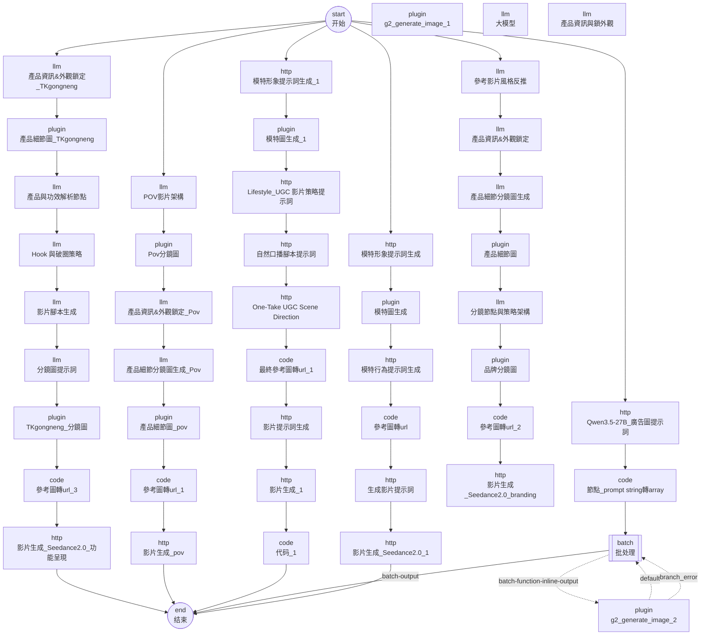

# 社群影片生成(viedo0526) — DAG 連線圖與執行順序

來源:`viedo0526/workflow/viedo0526-draft.yaml`(Coze 匯出,已消毒;金鑰為 `${VAR}` 佔位符)

| 統計 | 值 |
| --- | --- |
| 節點總數(含批次子節點) | 48 |
| 頂層節點 | 47 |
| 批次容器內子節點 | 1 |
| 頂層連線 | 47 |
| 批次容器內部連線 | 3 |
| DAG 最大層深 | 10 |
| 條件分支節點 | 0 |
| 批次節點 | 1 |
| 節點型別分布 | batch×1, code×7, end×1, http×14, llm×14, plugin×10, start×1 |

## 執行順序(拓樸排序)

| # | 層深 | 型別 | 節點 | ID | 可否本機執行 | 節點檔 |
| --- | --- | --- | --- | --- | --- | --- |
| 1 | 0 | start | 开始 | `100001` | 是 | [01-开始.md](nodes/01-开始.md) |
| 2 | 1 | http | 模特形象提示詞生成 | `186013` | 是 | [02-模特形象提示詞生成.md](nodes/02-模特形象提示詞生成.md) |
| 3 | 0 | plugin | g2_generate_image_1 ⚠孤立 | `1168640` | 否(需 Coze) | [03-g2_generate_image_1.md](nodes/03-g2_generate_image_1.md) |
| 4 | 1 | http | Qwen3.5-27B_廣告圖提示詞 | `1942015` | 是 | [04-Qwen3.5-27B_廣告圖提示詞.md](nodes/04-Qwen3.5-27B_廣告圖提示詞.md) |
| 5 | 2 | code | 節點_prompt string轉array | `105725` | 是 | [05-節點_prompt_string轉array.md](nodes/05-節點_prompt_string轉array.md) |
| 6 | 3 | batch | 批处理 | `139589` | 否(需 Coze) | [06-批处理.md](nodes/06-批处理.md) |
| 7 | 0 | plugin | g2_generate_image_2 | `1777653` | 否(需 Coze) | [07-g2_generate_image_2.md](nodes/07-g2_generate_image_2.md) |
| 8 | 2 | plugin | 模特圖生成 | `164877` | 否(需 Coze) | [08-模特圖生成.md](nodes/08-模特圖生成.md) |
| 9 | 3 | http | 模特行為提示詞生成 | `1457648` | 是 | [09-模特行為提示詞生成.md](nodes/09-模特行為提示詞生成.md) |
| 10 | 4 | code | 參考圖轉url | `1860244` | 是 | [10-參考圖轉url.md](nodes/10-參考圖轉url.md) |
| 11 | 1 | http | 模特形象提示詞生成_1 | `1319527` | 是 | [11-模特形象提示詞生成_1.md](nodes/11-模特形象提示詞生成_1.md) |
| 12 | 2 | plugin | 模特圖生成_1 | `1715862` | 否(需 Coze) | [12-模特圖生成_1.md](nodes/12-模特圖生成_1.md) |
| 13 | 3 | http | Lifestyle_UGC 影片策略提示詞 | `1310676` | 是 | [13-Lifestyle_UGC_影片策略提示詞.md](nodes/13-Lifestyle_UGC_影片策略提示詞.md) |
| 14 | 4 | http | 自然口播腳本提示詞 | `1582413` | 是 | [14-自然口播腳本提示詞.md](nodes/14-自然口播腳本提示詞.md) |
| 15 | 5 | http | One-Take UGC Scene Direction | `1441357` | 是 | [15-One-Take_UGC_Scene_Direction.md](nodes/15-One-Take_UGC_Scene_Direction.md) |
| 16 | 6 | code | 最終參考圖轉url_1 | `1273810` | 是 | [16-最終參考圖轉url_1.md](nodes/16-最終參考圖轉url_1.md) |
| 17 | 7 | http | 影片提示詞生成 | `1222376` | 是 | [17-影片提示詞生成.md](nodes/17-影片提示詞生成.md) |
| 18 | 8 | http | 影片生成_1 | `1489324` | 是 | [18-影片生成_1.md](nodes/18-影片生成_1.md) |
| 19 | 9 | code | 代码_1 | `1830533` | 是 | [19-代码_1.md](nodes/19-代码_1.md) |
| 20 | 5 | http | 生成影片提示詞 | `1135706` | 是 | [20-生成影片提示詞.md](nodes/20-生成影片提示詞.md) |
| 21 | 6 | http | 影片生成_Seedance2.0_1 | `1998024` | 是 | [21-影片生成_Seedance2.0_1.md](nodes/21-影片生成_Seedance2.0_1.md) |
| 22 | 0 | llm | 大模型 ⚠孤立 | `112412` | 否(需 Coze) | [22-大模型.md](nodes/22-大模型.md) |
| 23 | 1 | llm | POV影片架構 | `163246` | 否(需 Coze) | [23-POV影片架構.md](nodes/23-POV影片架構.md) |
| 24 | 0 | llm | 產品資訊與鎖外觀 ⚠孤立 | `137979` | 否(需 Coze) | [24-產品資訊與鎖外觀.md](nodes/24-產品資訊與鎖外觀.md) |
| 25 | 2 | plugin | Pov分鏡圖 | `1977031` | 否(需 Coze) | [25-Pov分鏡圖.md](nodes/25-Pov分鏡圖.md) |
| 26 | 3 | llm | 產品資訊&外觀鎖定_Pov | `1677938` | 否(需 Coze) | [26-產品資訊&外觀鎖定_Pov.md](nodes/26-產品資訊&外觀鎖定_Pov.md) |
| 27 | 4 | llm | 產品細節分鏡圖生成_Pov | `1314338` | 否(需 Coze) | [27-產品細節分鏡圖生成_Pov.md](nodes/27-產品細節分鏡圖生成_Pov.md) |
| 28 | 5 | plugin | 產品細節圖_pov | `1103273` | 否(需 Coze) | [28-產品細節圖_pov.md](nodes/28-產品細節圖_pov.md) |
| 29 | 6 | code | 參考圖轉url_1 | `1404396` | 是 | [29-參考圖轉url_1.md](nodes/29-參考圖轉url_1.md) |
| 30 | 7 | http | 影片生成_pov | `1585252` | 是 | [30-影片生成_pov.md](nodes/30-影片生成_pov.md) |
| 31 | 1 | llm | 參考影片風格反推 | `131447` | 否(需 Coze) | [31-參考影片風格反推.md](nodes/31-參考影片風格反推.md) |
| 32 | 2 | llm | 產品資訊&外觀鎖定 | `116531` | 否(需 Coze) | [32-產品資訊&外觀鎖定.md](nodes/32-產品資訊&外觀鎖定.md) |
| 33 | 3 | llm | 產品細節分鏡圖生成 | `196092` | 否(需 Coze) | [33-產品細節分鏡圖生成.md](nodes/33-產品細節分鏡圖生成.md) |
| 34 | 4 | plugin | 產品細節圖 | `176487` | 否(需 Coze) | [34-產品細節圖.md](nodes/34-產品細節圖.md) |
| 35 | 5 | llm | 分鏡節點與策略架構 | `133383` | 否(需 Coze) | [35-分鏡節點與策略架構.md](nodes/35-分鏡節點與策略架構.md) |
| 36 | 6 | plugin | 品牌分鏡圖 | `178234` | 否(需 Coze) | [36-品牌分鏡圖.md](nodes/36-品牌分鏡圖.md) |
| 37 | 7 | code | 參考圖轉url_2 | `189371` | 是 | [37-參考圖轉url_2.md](nodes/37-參考圖轉url_2.md) |
| 38 | 8 | http | 影片生成_Seedance2.0_branding | `106692` | 是 | [38-影片生成_Seedance2.0_branding.md](nodes/38-影片生成_Seedance2.0_branding.md) |
| 39 | 1 | llm | 產品資訊&外觀鎖定_TKgongneng | `1196782` | 否(需 Coze) | [39-產品資訊&外觀鎖定_TKgongneng.md](nodes/39-產品資訊&外觀鎖定_TKgongneng.md) |
| 40 | 2 | plugin | 產品細節圖_TKgongneng | `1807253` | 否(需 Coze) | [40-產品細節圖_TKgongneng.md](nodes/40-產品細節圖_TKgongneng.md) |
| 41 | 3 | llm | 產品與功效解析節點 | `121916` | 否(需 Coze) | [41-產品與功效解析節點.md](nodes/41-產品與功效解析節點.md) |
| 42 | 4 | llm | Hook 與破圈策略 | `1139732` | 否(需 Coze) | [42-Hook_與破圈策略.md](nodes/42-Hook_與破圈策略.md) |
| 43 | 5 | llm | 影片腳本生成 | `121547` | 否(需 Coze) | [43-影片腳本生成.md](nodes/43-影片腳本生成.md) |
| 44 | 6 | llm | 分鏡圖提示詞 | `156491` | 否(需 Coze) | [44-分鏡圖提示詞.md](nodes/44-分鏡圖提示詞.md) |
| 45 | 7 | plugin | TKgongneng_分鏡圖 | `1998343` | 否(需 Coze) | [45-TKgongneng_分鏡圖.md](nodes/45-TKgongneng_分鏡圖.md) |
| 46 | 8 | code | 參考圖轉url_3 | `1717375` | 是 | [46-參考圖轉url_3.md](nodes/46-參考圖轉url_3.md) |
| 47 | 9 | http | 影片生成_Seedance2.0_功能呈現 | `1453736` | 是 | [47-影片生成_Seedance2.0_功能呈現.md](nodes/47-影片生成_Seedance2.0_功能呈現.md) |
| 48 | 10 | end | 结束 | `900001` | 是 | [48-结束.md](nodes/48-结束.md) |

## 連線明細(頂層)

| 來源 | port | 目標 |
| --- | --- | --- |
| `100001` 开始 | default | `1196782` 產品資訊&外觀鎖定_TKgongneng |
| `100001` 开始 | default | `186013` 模特形象提示詞生成 |
| `100001` 开始 | default | `1319527` 模特形象提示詞生成_1 |
| `100001` 开始 | default | `1942015` Qwen3.5-27B_廣告圖提示詞 |
| `100001` 开始 | default | `163246` POV影片架構 |
| `100001` 开始 | default | `131447` 參考影片風格反推 |
| `1453736` 影片生成_Seedance2.0_功能呈現 | default | `900001` 结束 |
| `1585252` 影片生成_pov | default | `900001` 结束 |
| `1830533` 代码_1 | default | `900001` 结束 |
| `139589` 批处理 | batch-output | `900001` 结束 |
| `1998024` 影片生成_Seedance2.0_1 | default | `900001` 结束 |
| `186013` 模特形象提示詞生成 | default | `164877` 模特圖生成 |
| `1715862` 模特圖生成_1 | default | `1310676` Lifestyle_UGC 影片策略提示詞 |
| `1310676` Lifestyle_UGC 影片策略提示詞 | default | `1582413` 自然口播腳本提示詞 |
| `1441357` One-Take UGC Scene Direction | default | `1273810` 最終參考圖轉url_1 |
| `1273810` 最終參考圖轉url_1 | default | `1222376` 影片提示詞生成 |
| `1222376` 影片提示詞生成 | default | `1489324` 影片生成_1 |
| `1489324` 影片生成_1 | default | `1830533` 代码_1 |
| `1942015` Qwen3.5-27B_廣告圖提示詞 | default | `105725` 節點_prompt string轉array |
| `105725` 節點_prompt string轉array | default | `139589` 批处理 |
| `164877` 模特圖生成 | default | `1457648` 模特行為提示詞生成 |
| `1457648` 模特行為提示詞生成 | default | `1860244` 參考圖轉url |
| `1135706` 生成影片提示詞 | default | `1998024` 影片生成_Seedance2.0_1 |
| `1860244` 參考圖轉url | default | `1135706` 生成影片提示詞 |
| `1582413` 自然口播腳本提示詞 | default | `1441357` One-Take UGC Scene Direction |
| `1319527` 模特形象提示詞生成_1 | default | `1715862` 模特圖生成_1 |
| `163246` POV影片架構 | default | `1977031` Pov分鏡圖 |
| `1103273` 產品細節圖_pov | default | `1404396` 參考圖轉url_1 |
| `1404396` 參考圖轉url_1 | default | `1585252` 影片生成_pov |
| `1977031` Pov分鏡圖 | default | `1677938` 產品資訊&外觀鎖定_Pov |
| `1677938` 產品資訊&外觀鎖定_Pov | default | `1314338` 產品細節分鏡圖生成_Pov |
| `1314338` 產品細節分鏡圖生成_Pov | default | `1103273` 產品細節圖_pov |
| `131447` 參考影片風格反推 | default | `116531` 產品資訊&外觀鎖定 |
| `116531` 產品資訊&外觀鎖定 | default | `196092` 產品細節分鏡圖生成 |
| `176487` 產品細節圖 | default | `133383` 分鏡節點與策略架構 |
| `133383` 分鏡節點與策略架構 | default | `178234` 品牌分鏡圖 |
| `178234` 品牌分鏡圖 | default | `189371` 參考圖轉url_2 |
| `189371` 參考圖轉url_2 | default | `106692` 影片生成_Seedance2.0_branding |
| `196092` 產品細節分鏡圖生成 | default | `176487` 產品細節圖 |
| `1807253` 產品細節圖_TKgongneng | default | `121916` 產品與功效解析節點 |
| `121916` 產品與功效解析節點 | default | `1139732` Hook 與破圈策略 |
| `1139732` Hook 與破圈策略 | default | `121547` 影片腳本生成 |
| `1196782` 產品資訊&外觀鎖定_TKgongneng | default | `1807253` 產品細節圖_TKgongneng |
| `121547` 影片腳本生成 | default | `156491` 分鏡圖提示詞 |
| `156491` 分鏡圖提示詞 | default | `1998343` TKgongneng_分鏡圖 |
| `1998343` TKgongneng_分鏡圖 | default | `1717375` 參考圖轉url_3 |
| `1717375` 參考圖轉url_3 | default | `1453736` 影片生成_Seedance2.0_功能呈現 |

## 批次容器內部連線

| 容器 | 來源 | source_port | 目標 | target_port |
| --- | --- | --- | --- | --- |
| `139589` | `139589` | batch-function-inline-output | `1777653` | - |
| `139589` | `1777653` | default | `139589` | batch-function-inline-input |
| `139589` | `1777653` | branch_error | `139589` | batch-function-inline-input |

## Mermaid

## 未連到起始節點的節點(孤立 / 停用分支)

這些節點在 Coze 畫布上存在但**沒有任何從 `start` 出發的路徑可以到達**,屬於作者留在畫布上的舊版或備用分支。已完整保留,執行時不會被觸發。

- `1168640` g2_generate_image_1(plugin)
- `112412` 大模型(llm)
- `137979` 產品資訊與鎖外觀(llm)

